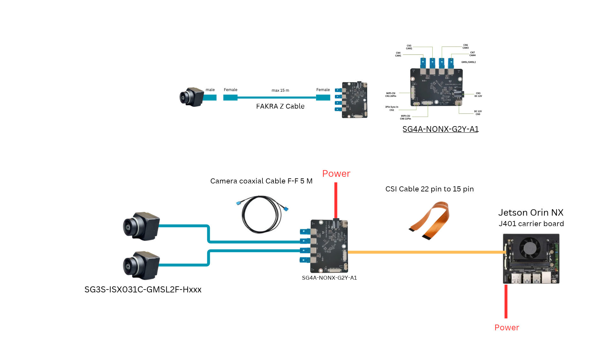

# sensing-j401 — ติดตั้งกล้อง SENSING SG4A บน Seeed J401 (JetPack 6.1)

คู่มือนี้เริ่มจาก Jetson ที่เพิ่งแฟลช JetPack 6.1 เสร็จ (ผ่าน first-boot setup แล้ว ชื่อ user อะไรก็ได้ คู่มือใช้ `$HOME` แทน path ของ user) ไปจนถึงรับภาพจากกล้องได้ ทุกคำสั่งรันบน Jetson ผ่าน SSH หรือ terminal ของเครื่อง ทำตามลำดับ ห้ามข้ามขั้น

| ขั้น | ดำเนินการ 
|---|---|
| 1 | ตรวจเครื่องหลังแฟลช 
| 2 | ล็อก package L4T
| 3 | ติดตั้ง git, git-lfs, dependencies 
| 4 | Clone repo และเตรียมไฟล์ 
| 4.1 | กรอกไฟล์ RELEASE 
| 4.2 | ตรวจ binary กับ kernel
| 5 | ตรวจก่อนติดตั้ง 
| 6 | สำรองของเดิม
| 7 | ติดตั้ง camera stack 
| 8 | ติดตั้ง driver, helper, loader, service 
| 9 | Compile และติดตั้ง overlay 
| 10 | เพิ่ม boot entry ใน extlinux 
| 11 | เปิด service และ reboot 
| 12 | ตรวจหลังบูต 
| 13 | ทดสอบภาพนิ่งและวิดีโอ 
| 14 | ย้อนกลับ 
| 15 | แก้ปัญหา 


## โครงสร้าง repo

```text
sensing-j401/
├── README.md
├── .gitattributes
├── .gitignore
├── common/                         
│   ├── dts/sensing-j401-j9-2lane.dts    
│   ├── helpers/
│   │   ├── check-abi.sh                     
│   │   ├── configure-2lane.py               
│   │   └── restore-serializer-address.py    
│   ├── loader/sensing-j401-load            
│   ├── sy
stemd/sensing-camera-load.service  
│   └── capture/
│       ├── capture.sh                      
│       ├── record-60s.py                    
│       └── stream.sh                        
├── docs/
│   ├── SUCCESS-SETUP-jp62.md
│   └── SETUP-JP61.md
└── jetpack-6.1-r36.4.2/
    ├── RELEASE                              
    ├── SHA256SUMS                           
    ├── modules/
    │   ├── max96712.ko                     
    │   └── sgx-yuv-gmsl2.ko                
    └── kernel/←
        ├── tegra-camera.ko               
        └── nvhost-nvcsi-t194.ko            
```

ใช้ kernel `Image` เดิมของเครื่อง (5.15.148-tegra จาก JetPack 6.1) ไม่ได้เก็บใน repo และ repo เปลี่ยนเฉพาะโมดูล camera stack

DTBO ไม่ได้เก็บใน repo ขั้นตอนที่ 9 compile จาก `common/dts` บนเครื่องทุกครั้ง และทดสอบกับ base DTB ของเครื่องนั้นก่อนติดตั้ง

**ภาพรวมการทำงานหลังติดตั้ง:** เปิดเครื่อง → bootloader โหลด overlay (บอก kernel ว่ามีกล้องที่ J9) → service เรียก loader → loader โหลด `max96712.ko` และ `sgx-yuv-gmsl2.ko` แล้วตั้งค่า 2-lane → ได้ `/dev/video2` พร้อมถ่ายภาพ

---

## ต่ออุปกรณ์เข้ากับ Jetson
- Camera : SG3S-ISX031C-GMSL2F-Hxxx
- Board : SG4A-NONX-G2Y-A1
- Edge : Jetson Orin nx (J401 carrier board)
- CSI cable 22 pin to 15 pin




ต่อสายให้เรียบร้อยก่อนเปิดเครื่อง กล้องต้องต่อที่พอร์ต 2 ของบอร์ด SG4A (driver ตั้งไว้ที่ `cam_2@1c`) และสาย CSI เข้าที่ช่อง J9 ของ J401

## 1. ตรวจเครื่องหลังแฟลช

สำหรับใช้ ssh เข้าบนเครื่อง Jetson

```bash
whoami
ifconfig
```
- `whoami` ดูชื่อ user ที่ login อยู่
- `ifconfig` ดู IP ของ Jetson ไว้ใช้ SSH IP อยู่หลังคำว่า `inet` ใต้ `eth0` (สาย LAN) หรือ `wlan0` (Wi-Fi) เช่น `inet 192.168.1.50`
### คำสั่ง ssh

ให้สั่งงาน Jetson จากคอมพิวเตอร์ของเราได้ copy/paste คำสั่งในคู่มือสะดวกกว่าพิมพ์บนจอ Jetson

```bash
ssh user@ip
```
- แทน `user` ด้วยผลของ `whoami` และ `ip` ด้วย IP จาก `ifconfig` เช่น `ssh jetson@192.168.1.50`
ครั้งแรกจะถาม `Are you sure you want to continue connecting (yes/no...)?` ให้พิมพ์ `yes` แล้วใส่รหัสผ่านของ user บน Jetson เมื่อเข้าได้ prompt จะเปลี่ยนเป็น `user@ชื่อเครื่อง:~$`


เพื่อยืนยันว่าเครื่องเป็น JetPack 6.1 / kernel ตรงกับ binary ใน repo ต่อเน็ตได้ และเวลาถูก ถ้ารุ่นไม่ตรง driver จะโหลดไม่ได้ ถ้าเวลาเพี้ยน apt จะใช้ไม่ได้

```bash
head -n1 /etc/nv_tegra_release
uname -r
```
- `head -n1 /etc/nv_tegra_release` ดูรุ่น L4T (JetPack) ที่แฟลชมา ขึ้นต้นด้วย `# R36 (release), REVISION: 4.` (ใช้ในขั้นตอนที่ 4) 
- `uname -r` ดูรุ่น kernel `5.15.148-tegra` 
```bash
ping -c 3 github.com
timedatectl
```
- `ping -c 3 github.com`  ทดสอบอินเทอร์เน็ต
- `timedatectl` ดูเวลาและการซิงก์เวลา `System clock synchronized: yes` และวันที่ถูกต้อง

ตัวอย่างผลลัพธ์บางส่วน:

```text
# R36 (release), REVISION: 4.0, GCID: ..., BOARD: generic, EABI: aarch64, DATE: ...
5.15.148-tegra
<ชื่อ user>
3 packets transmitted, 3 received, 0% packet loss, time ...
               Local time: ...
System clock synchronized: yes
```

### ถ้าเวลาไม่ซิงก์

`timedatectl` ขึ้น `System clock synchronized: no` หรือวันที่ผิด ถ้าไม่แก้ `apt-get update` จะ error ว่า `Release file ... is not valid yet`

```bash
sudo timedatectl set-ntp true
sleep 10; timedatectl
```
- `sudo timedatectl set-ntp true` เปิดการซิงก์เวลาจากอินเทอร์เน็ต (NTP) 
- `sleep 10; timedatectl` รอ 10 วินาทีให้ซิงก์ แล้วดูผลอีกครั้ง ต้องได้ `System clock synchronized: yes` 

## 2. ล็อก package ของ L4T ก่อนใช้ apt

repo apt `r36.4` ของ NVIDIA ส่ง package ของ R36.4.3 (JetPack 6.2) มาด้วย ถ้าไม่ล็อกไว้ การ `apt upgrade` จะอัปเกรดเครื่องข้ามไป 6.2 และเขียนทับ kernel/modules กล้อง ทำขั้นนี้ก่อนใช้ apt ครั้งแรก

```bash
sudo apt-mark hold nvidia-l4t-display-kernel nvidia-l4t-kernel nvidia-l4t-kernel-dtbs nvidia-l4t-kernel-headers nvidia-l4t-kernel-oot-headers nvidia-l4t-kernel-oot-module
apt-mark showhold
```
- `sudo apt-mark hold ...` ล็อก 6 package ที่เป็น kernel / device tree / โมดูลของ NVIDIA ไม่ให้ apt อัปเกรด ขึ้น `... set on hold.` ทีละ package
- `apt-mark showhold` แสดงรายการ package ที่ล็อกอยู่ ต้องแสดงครบทั้ง 6 package

ตัวอย่างผลลัพธ์:

```text
nvidia-l4t-display-kernel set on hold.
nvidia-l4t-kernel set on hold.
...
nvidia-l4t-display-kernel
nvidia-l4t-kernel
nvidia-l4t-kernel-dtbs
nvidia-l4t-kernel-headers
nvidia-l4t-kernel-oot-headers
nvidia-l4t-kernel-oot-module
```

ห้ามรัน `sudo apt upgrade` บนเครื่องนี้ ใช้ `apt-get install` เฉพาะ package ที่ต้องการเท่านั้น

## 3. ติดตั้ง git, git-lfs และ dependencies

ติดตั้งเครื่องมือที่ขั้นถัดไปเรียกใช้ ต้องติดตั้ง `git-lfs` **ก่อน** clone ไม่อย่างนั้นไฟล์ `.ko` จะเป็นแค่ LFS pointer ขนาด ~130 ไบต์ (ไฟล์ข้อความที่ชี้ไปหาไฟล์จริง ไม่ใช่ driver)

```bash
sudo apt-get update
sudo apt-get install -y git git-lfs i2c-tools v4l-utils device-tree-compiler gstreamer1.0-tools gstreamer1.0-plugins-base gstreamer1.0-plugins-good python3-pil python3-gi gir1.2-gstreamer-1.0 gir1.2-gst-plugins-base-1.0
git lfs install
```
- `sudo apt-get update` โหลดรายชื่อ package ล่าสุด (ไม่ได้อัปเกรดอะไร)
- `sudo apt-get install -y ...` ติดตั้ง package
- `git lfs install` เปิดใช้ git-lfs กับ user นี้ ต้องขึ้น `Git LFS initialized.`

## 4. Clone repo และเตรียมไฟล์

ดาวน์โหลดไฟล์ทั้งหมดของ repo มาไว้ที่ `$HOME/sensing-j401`

```bash
git clone https://github.com/pppalzz03/Setup-J401.git $HOME/sensing-j401
cd $HOME/sensing-j401
git lfs pull
git lfs ls-files
```
- `git clone ...` ดาวน์โหลด repo ไปไว้ที่ `$HOME/sensing-j401` ถ้า repo เป็น private git จะถาม username/password ให้ใส่ GitHub username และ Personal Access Token (ไม่ใช่รหัสผ่าน GitHub)
- `cd $HOME/sensing-j401` เข้าไปในโฟลเดอร์ repo
- `git lfs pull` ดึงไฟล์ `.ko` ตัวจริงแทน pointer (กันกรณีตอน clone ดึงไม่ครบ)
- `git lfs ls-files` ต้องแสดง `.ko` ครบ 4 ไฟล์ เครื่องหมาย `*` หมายถึงได้ไฟล์จริงแล้ว ถ้าเป็น `-` แปลว่ายังเป็น pointer ให้รัน `git lfs pull` อีกครั้ง

ตัวอย่างผลลัพธ์ของ `git lfs ls-files`:

```text
... * jetpack-6.1-r36.4.2/kernel/nvhost-nvcsi-t194.ko
... * jetpack-6.1-r36.4.2/kernel/tegra-camera.ko
... * jetpack-6.1-r36.4.2/modules/max96712.ko
... * jetpack-6.1-r36.4.2/modules/sgx-yuv-gmsl2.ko
```

ตั้งตัวแปรที่ใช้ทุกขั้นตอนต่อจากนี้ และบันทึกลง `~/.bashrc` เพื่อให้ terminal ที่เปิดใหม่ (รวมถึงหลัง reboot) มีตัวแปรเลย คำสั่งในขั้นต่อไปจะได้สั้นและไม่ต้องพิมพ์ path ยาว

```bash
grep -q 'REPO=$HOME/sensing-j401' ~/.bashrc || cat >> ~/.bashrc <<'EOF'
REPO=$HOME/sensing-j401
BSP=$REPO/jetpack-6.1-r36.4.2
EOF
source ~/.bashrc
echo "$REPO" "$BSP"
```
- `grep -q ... || cat >> ~/.bashrc ...` เพิ่ม 2 บรรทัดลง `~/.bashrc` เฉพาะเมื่อยังไม่มี (รันซ้ำได้ ไม่เพิ่มซ้ำ)
- `source ~/.bashrc` โหลดตัวแปรเข้า terminal ปัจจุบันทันที
- `echo "$REPO" "$BSP"` แสดงค่าตัวแปร ต้องได้ `/home/<user>/sensing-j401 /home/<user>/sensing-j401/jetpack-6.1-r36.4.2` ถ้าว่าง คำสั่งในขั้นต่อไปจะผิด path ทั้งหมด ให้รัน `source ~/.bashrc` อีกครั้ง

> **ระหว่างติดตั้ง ถ้าต้องอัปเดต repo ให้ใช้ `git -C $REPO pull` เท่านั้น** ห้ามใช้ `git checkout -- .`, `git stash`, `git reset` เพราะจะล้างไฟล์ RELEASE ที่กรอกในขั้นตอน 4.1

### 4.1 กรอกไฟล์ RELEASE

ไฟล์ `RELEASE` ใน repo ว่างไว้ ต้องกรอกจากเครื่องจริง ค่านี้ใช้ตรวจว่าเครื่องตรงกับ binary ในขั้นที่ 5 และ loader ใช้ตรวจทุกครั้งที่บูต (ถ้าเครื่องถูกอัปเกรด L4T ไป loader จะไม่โหลด driver) คำสั่ง `skip-worktree` ทำให้ git ไม่แตะไฟล์นี้อีก (ไม่ถูกล้างตอน `git pull` และไม่ถูก commit โดยไม่ตั้งใจ)

```bash
if [ ! -s $BSP/RELEASE ]; then
  head -n1 /etc/nv_tegra_release | grep -o '^# R[0-9]* (release), REVISION: [0-9.]*,' > $BSP/RELEASE
fi
git -C $REPO update-index --skip-worktree jetpack-6.1-r36.4.2/RELEASE
cat $BSP/RELEASE
```
- `if [ ! -s $BSP/RELEASE ]; then ... fi` ถ้า RELEASE ยังว่าง ให้ตัดส่วนต้นของบรรทัดแรกใน `/etc/nv_tegra_release` มาเขียนลงไฟล์ (รันซ้ำได้ ไม่ทับค่าที่กรอกแล้ว)
- `git ... --skip-worktree ...` บอก git ให้เลิกติดตามการเปลี่ยนแปลงของไฟล์นี้
- `cat $BSP/RELEASE` ต้องได้บรรทัดเดียว เช่น `# R36 (release), REVISION: 4.0,` ถ้าว่าง ให้รันชุดคำสั่งนี้ซ้ำ

ดูค่า REVISION ที่ได้:

| ได้ | ทำต่อ |
|---|---|
| `REVISION: 4.2,` | ตรงกับชื่อโฟลเดอร์ ข้าม 4.2 ไปขั้นตอนที่ 5 ได้เลย |
| เลขอื่น เช่น `REVISION: 4.0,` | ทำ 4.2 ก่อน ห้ามข้าม |

### 4.2 ตรวจว่า binary โหลดได้บนเครื่องนี้ (ทำเมื่อ REVISION ไม่ใช่ 4.2)

R36.4.x ทุกรุ่นใช้ kernel `5.15.148-tegra` เหมือนกัน vermagic จึงแยกไม่ออก สคริปต์นี้เทียบ CRC ของ symbol ระหว่าง `.ko` ใน repo กับ kernel ของเครื่อง ถ้าไม่ตรงแล้วฝืนติดตั้ง driver จะโหลดไม่ได้ อ่านอย่างเดียว ไม่เปลี่ยนอะไรในเครื่อง

```bash
sudo apt-get install -y binutils
bash $REPO/common/helpers/check-abi.sh $BSP
```
- `sudo apt-get install -y binutils` ติดตั้งคำสั่ง `nm` ที่สคริปต์ใช้อ่าน symbol ใน `.ko`
- `bash .../check-abi.sh $BSP` ตรวจ 3 กลุ่ม: [1] โมดูลใน repo กับ kernel เครื่อง [2] โมดูลใน repo กันเอง [3] โมดูลเดิมของเครื่องที่ใช้ tegra-camera ทุกกลุ่มต้อง `diff=0` ยกเว้นบรรทัดที่มี `WARN`

ตัวอย่างผลลัพธ์:

```text
[1] โมดูลใน repo เทียบกับ kernel/nvidia-oot ของเครื่อง
== tegra-camera.ko
    checked=... diff=0
== max96712.ko
    checked=... diff=0
[2] โมดูลใน repo เทียบกับ tegra-camera.ko ใน repo
...
[3] โมดูลเดิมของเครื่องที่ใช้ tegra-camera เทียบกับ tegra-camera.ko ใน repo
...
WARN: driver กล้องของ NVIDIA ... ตัวจะใช้ไม่ได้หลังติดตั้ง (imx219, imx477 ฯลฯ) ...
PASS: binary ชุดนี้โหลดได้บนเครื่องนี้
```

ไม่ต้องติดตั้ง `nvidia-l4t-kernel-headers` เพิ่ม เพราะติดมากับการแฟลชแล้ว ถ้าสั่ง `apt-get install nvidia-l4t-kernel-headers` โดยไม่ระบุเวอร์ชัน apt จะพยายามดึงรุ่นใหม่กว่า (เช่น 36.4.7) แล้วขึ้น `unmet dependencies ... held broken packages` แปลว่า hold ในขั้นตอนที่ 2 ทำงานถูกต้อง ห้ามปลด hold

`WARN` เป็นเรื่องปกติ: `tegra-camera.ko` ใน repo ถูกแก้สำหรับ SENSING ทำให้ driver กล้องตัวอย่างของ NVIDIA (`nv_imx219`, `nv_imx477` ฯลฯ) โหลดไม่ได้หลังติดตั้ง ไม่กระทบกล้อง SENSING แต่ห้ามเปิด overlay กล้อง NVIDIA ผ่าน Jetson-IO

## 5. ตรวจก่อนติดตั้ง

ด่านสุดท้ายก่อนเริ่มแก้ไฟล์ระบบ ตรวจว่ารุ่นเครื่อง ไฟล์ใน repo และ path บนเครื่องตรงกับที่ขั้น 6–10 จะใช้ ทุกคำสั่งอ่านอย่างเดียว รันซ้ำได้

ตรวจรุ่น L4T และ kernel

```bash
head -n1 /etc/nv_tegra_release
cat $BSP/RELEASE
test -s $BSP/RELEASE && head -n1 /etc/nv_tegra_release | grep -qF "$(cat $BSP/RELEASE)" && echo "OK: L4T release ตรง" || echo "STOP: RELEASE ว่าง หรือไม่ตรงกับเครื่อง (ทำ 4.1 ใหม่)"

[ "$(uname -r)" = "5.15.148-tegra" ] && echo "OK: kernel" || echo "STOP: kernel"
```
- `head -n1 /etc/nv_tegra_release` และ `cat $BSP/RELEASE` แสดงรุ่นของเครื่องและค่าใน RELEASE ไว้เทียบด้วยตา
- `test -s ... && ... grep -qF ...` เทียบให้อัตโนมัติ ต้องได้ `OK: L4T release ตรง`
- `[ "$(uname -r)" = "5.15.148-tegra" ] ...` ต้องได้ `OK: kernel`

ตรวจไฟล์ใน repo

```bash
(cd $BSP && sha256sum -c SHA256SUMS)

file $BSP/modules/*.ko $BSP/kernel/*.ko
file $REPO/common/loader/sensing-j401-load $REPO/common/capture/capture.sh $REPO/common/helpers/*.py
```
- `sha256sum -c SHA256SUMS` ตรวจว่าไฟล์ binary ไม่เสียหรือถูกแก้ ทุกไฟล์ต้องขึ้น `OK` เช่น `modules/max96712.ko: OK`
- `file ...*.ko` ตรวจว่าเป็น driver จริง ต้องขึ้น `ELF 64-bit LSB relocatable, ARM aarch64 ...` ถ้าขึ้น `ASCII text` คือยังเป็น LFS pointer
- `file .../sensing-j401-load ...` ตรวจรูปแบบขึ้นบรรทัดของสคริปต์ ต้องไม่มีคำว่า `CRLF`

ตรวจ driver

```bash
modinfo -F vermagic $BSP/modules/max96712.ko
modinfo -p $BSP/modules/sgx-yuv-gmsl2.ko | grep GMSLMODE_1
```
- `modinfo -F vermagic` ดูว่า driver build มาสำหรับ kernel อะไร ต้องขึ้นต้นด้วย `5.15.148-tegra`
- `modinfo -p ... | grep GMSLMODE_1` ยืนยันว่า driver รองรับการตั้งโหมด GMSL (3G) ต้องมีบรรทัดที่ขึ้นต้นด้วย `GMSLMODE_1:`

ตรวจฮาร์ดแวร์และ path บนเครื่อง

```bash
i2cdetect -l
ls /boot/dtb/
ls /lib/modules/5.15.148-tegra/updates/drivers/video/tegra/host/nvcsi/
```
- `i2cdetect -l` แสดง I2C bus ทั้งหมด ต้องมี bus 9 (`i2c-9`) ที่เป็น camera mux เพราะ helper ใช้ bus 9 คุยกับกล้อง
- `ls /boot/dtb/` ต้องมี `kernel_tegra234-p3768-0000+p3767-0000-nv.dtb` (ใช้ในขั้น 9–10)
- `ls .../nvcsi/` ต้องมี `nvhost-nvcsi-t194.ko` (ใช้ในขั้น 6, 7, 14)

ทุกข้อต้องผ่านก่อนไปต่อ:

| ตรวจ | ต้องได้ | ถ้าไม่ได้ |
|---|---|---|
| release | `OK: L4T release ตรง` | แฟลชผิดรุ่น หรือ `RELEASE` ไม่ตรงเครื่อง ดูหัวข้อ "ไฟล์ RELEASE" ท้ายไฟล์ |
| kernel | `OK: kernel` | หยุด |
| sha256sum | ทุกไฟล์ `OK` | `git lfs pull` ใหม่ หรือไฟล์ใน repo ถูกแก้ |
| `file` ของ .ko | `ELF ... aarch64` | ถ้าขึ้น `ASCII text` คือยังเป็น LFS pointer ให้ `git lfs pull` |
| `file` ของสคริปต์ | ไม่มีคำว่า `CRLF` | ไฟล์ถูกแก้บน Windows แล้ว commit แบบ CRLF ให้ตรวจ `.gitattributes` แล้ว clone ใหม่ |
| vermagic | ขึ้นต้นด้วย `5.15.148-tegra` | โมดูลไม่ใช่ของ kernel นี้ |
| GMSLMODE_1 | มีบรรทัด parameter | driver ไม่ใช่ชุด SENSING ที่รองรับ 3G |
| I2C | มี bus 9 ที่เป็น camera mux | ถ้าเลขต่าง ต้องแก้ `'9'` ใน helper ทั้งสองไฟล์ |
| โฟลเดอร์ `nvcsi/` | มี `nvhost-nvcsi-t194.ko` | ถ้าชื่อต่าง ให้ใช้ชื่อจริงในขั้นตอนที่ 6, 7, 14 |
| `/boot/dtb/` | มี `kernel_tegra234-p3768-0000+p3767-0000-nv.dtb` | ถ้าชื่อต่าง ใช้ชื่อจริงแทนในขั้นตอนที่ 9–10 |

## 6. สำรองของเดิม

เก็บไฟล์ที่ขั้น 7 และ 10 จะเขียนทับ ไว้ใช้ย้อนกลับในขั้นที่ 14 **ทำครั้งเดียวก่อนขั้นที่ 7** ห้ามรันซ้ำหลังติดตั้งแล้ว เพราะจะเอาไฟล์ใหม่ไปทับไฟล์สำรองของเดิม

```bash
B=$HOME/Downloads/sensing-before-install
mkdir -p $B
sudo cp -a /boot/extlinux/extlinux.conf $B/
sudo cp -a /boot/initrd $B/
sudo cp -a /lib/modules/5.15.148-tegra/updates/drivers/media/platform/tegra/camera/tegra-camera.ko $B/
sudo cp -a /lib/modules/5.15.148-tegra/updates/drivers/video/tegra/host/nvcsi/nvhost-nvcsi-t194.ko $B/
ls -l $B
```
- `B=...` และ `mkdir -p $B` สร้างโฟลเดอร์สำรอง `~/Downloads/sensing-before-install`
- `sudo cp -a .../extlinux.conf` สำรองไฟล์ตั้งค่าการบูต (ขั้น 10 จะแก้)
- `sudo cp -a /boot/initrd` สำรอง initrd (ขั้น 7 จะสร้างใหม่)
- `sudo cp -a .../tegra-camera.ko` และ `.../nvhost-nvcsi-t194.ko` สำรองโมดูลเดิม 2 ตัว (ขั้น 7 จะทับ)
- `ls -l $B` ต้องเห็นครบ 4 ไฟล์ และขนาดไม่เป็น 0

ตัวอย่างผลลัพธ์:

```text
-rw-r--r-- 1 root root ... extlinux.conf
-rw-r--r-- 1 root root ... initrd
-rw-r--r-- 1 root root ... nvhost-nvcsi-t194.ko
-rw-r--r-- 1 root root ... tegra-camera.ko
```

## 7. ติดตั้ง camera stack

แทนที่ camera framework ของ NVIDIA 2 ตัวด้วยรุ่นที่แก้สำหรับ SENSING ถ้าไม่ทำ driver กล้องในขั้นที่ 8 จะโหลดไม่ได้ ผลจะมีหลัง reboot (ขั้นที่ 11)

| ต้นทางใน repo | ปลายทางบน Jetson |
|---|---|
| `jetpack-6.1-r36.4.2/kernel/tegra-camera.ko` | `/lib/modules/5.15.148-tegra/updates/drivers/media/platform/tegra/camera/tegra-camera.ko` |
| `jetpack-6.1-r36.4.2/kernel/nvhost-nvcsi-t194.ko` | `/lib/modules/5.15.148-tegra/updates/drivers/video/tegra/host/nvcsi/nvhost-nvcsi-t194.ko` |

```bash
sudo install -m 644 $BSP/kernel/tegra-camera.ko /lib/modules/5.15.148-tegra/updates/drivers/media/platform/tegra/camera/tegra-camera.ko
sudo install -m 644 $BSP/kernel/nvhost-nvcsi-t194.ko /lib/modules/5.15.148-tegra/updates/drivers/video/tegra/host/nvcsi/nvhost-nvcsi-t194.ko
sudo depmod -a 5.15.148-tegra
sudo update-initramfs -u -k 5.15.148-tegra
```
- `sudo install -m 644 ...` (2 บรรทัด) copy โมดูลจาก repo ไปทับของเดิม พร้อมตั้งสิทธิ์ไฟล์ ไม่แสดงข้อความ
- `sudo depmod -a 5.15.148-tegra` สร้างดัชนีความสัมพันธ์ของโมดูลใหม่ ให้ kernel รู้ว่าโมดูลไหนต้องโหลดคู่กับอะไร ไม่แสดงข้อความ
- `sudo update-initramfs -u -k ...` สร้าง initrd ใหม่ เพราะ initrd เก็บสำเนาโมดูลไว้ใช้ตอนบูต ถ้าไม่สร้างใหม่ตอนบูตจะยังโหลดตัวเก่า ใช้เวลาประมาณหนึ่งนาที ขึ้น `update-initramfs: Generating /boot/initrd.img-5.15.148-tegra` และต้องไม่มี `error`

## 8. ติดตั้ง SENSING driver, helper, loader และ service

วางไฟล์ทุกตัวที่ระบบใช้ตอนบูตไว้ในตำแหน่งที่ loader และ systemd หาเจอ driver กล้องไม่ได้ติดตั้งเข้า `/lib/modules` แต่ให้ loader โหลดเองตอนบูต เพื่อตรวจรุ่น L4T และ overlay ก่อนทุกครั้ง

| ต้นทางใน repo | ปลายทางบน Jetson | mode | หน้าที่ |
|---|---|---|---|
| `jetpack-6.1-r36.4.2/modules/max96712.ko` | `/usr/local/lib/sensing-j401/max96712.ko` | 644 | driver ชิป deserializer MAX96712 |
| `jetpack-6.1-r36.4.2/modules/sgx-yuv-gmsl2.ko` | `/usr/local/lib/sensing-j401/sgx-yuv-gmsl2.ko` | 644 | driver กล้อง ทำให้เกิด `/dev/video2` |
| `jetpack-6.1-r36.4.2/RELEASE` | `/usr/local/lib/sensing-j401/RELEASE` | 644 | ค่าที่ loader ใช้ตรวจรุ่น L4T ตอนบูต |
| `common/helpers/configure-2lane.py` | `/usr/local/lib/sensing-j401/configure-2lane.py` | 644 | ตั้ง MAX96712 ให้ส่ง MIPI 2-lane |
| `common/helpers/restore-serializer-address.py` | `/usr/local/lib/sensing-j401/restore-serializer-address.py` | 755 | คืน I2C address ของ serializer ที่ค้าง ก่อนโหลด driver |
| `common/loader/sensing-j401-load` | `/usr/local/sbin/sensing-j401-load` | 755 | สคริปต์โหลด driver ตอนบูต |
| `common/systemd/sensing-camera-load.service` | `/etc/systemd/system/sensing-camera-load.service` | 644 | ให้ systemd เรียก loader ทุกครั้งที่เปิดเครื่อง |
| `common/capture/capture.sh` | `$HOME/Downloads/sensing-capture/capture.sh` | 755 | สคริปต์ถ่ายภาพนิ่ง (ขั้น 13) |
| `common/capture/record-60s.py` | ใช้จาก repo ตรง ๆ | — | อัดวิดีโอ (ขั้น 13) |

```bash
sudo mkdir -p /usr/local/lib/sensing-j401
sudo install -m 644 $BSP/modules/max96712.ko $BSP/modules/sgx-yuv-gmsl2.ko $BSP/RELEASE /usr/local/lib/sensing-j401/
sudo install -m 644 $REPO/common/helpers/configure-2lane.py /usr/local/lib/sensing-j401/
sudo install -m 755 $REPO/common/helpers/restore-serializer-address.py /usr/local/lib/sensing-j401/
sudo install -m 755 $REPO/common/loader/sensing-j401-load /usr/local/sbin/sensing-j401-load
sudo install -m 644 $REPO/common/systemd/sensing-camera-load.service /etc/systemd/system/sensing-camera-load.service
```
- `sudo mkdir -p /usr/local/lib/sensing-j401` สร้างโฟลเดอร์เก็บ driver และ helper
- `sudo install ...` copy ไฟล์ไปตามตารางด้านบน พร้อมตั้งสิทธิ์ ไม่แสดงข้อความ ถ้าขึ้น `cannot stat` แปลว่าตัวแปร `$REPO` / `$BSP` ว่าง ให้กลับไปตั้งตัวแปรในขั้นที่ 4

```bash
mkdir -p $HOME/Downloads/sensing-capture
install -m 755 $REPO/common/capture/capture.sh $HOME/Downloads/sensing-capture/capture.sh
```
- `mkdir -p` และ `install` วางสคริปต์ถ่ายภาพไว้ที่ `~/Downloads/sensing-capture/` (ไม่ใช้ sudo เพราะเป็นไฟล์ของ user)

ตรวจผล (ไม่บังคับ)

```bash
ls -l /usr/local/lib/sensing-j401/ /usr/local/sbin/sensing-j401-load /etc/systemd/system/sensing-camera-load.service
```
- ต้องเห็น 5 ไฟล์ใน `/usr/local/lib/sensing-j401/` (`max96712.ko`, `sgx-yuv-gmsl2.ko`, `RELEASE`, `configure-2lane.py`, `restore-serializer-address.py`) และอีก 2 ไฟล์ที่เหลือ

loader อ่าน `/usr/local/lib/sensing-j401/RELEASE` ตอนบูต ถ้าเครื่องถูกอัปเกรด L4T ไปรุ่นอื่น service จะหยุดก่อนโหลดโมดูล

## 9. Compile และติดตั้ง overlay

kernel รู้จักฮาร์ดแวร์จาก device tree (DTB) overlay คือส่วนเสริมที่บอก kernel ว่ามีกล้องต่ออยู่ที่ J9 ผ่าน MAX96712 ถ้าไม่มี overlay จะไม่มี `cam_2@1c` และ loader จะไม่โหลด driver

compile และทดสอบก่อน (ผลอยู่ใน `/tmp` ไม่แตะ `/boot`)

```bash
dtc -@ -I dts -O dtb -o /tmp/sensing-j401-j9-2lane.dtbo $REPO/common/dts/sensing-j401-j9-2lane.dts

fdtoverlay \
  -i /boot/dtb/kernel_tegra234-p3768-0000+p3767-0000-nv.dtb \
  -o /tmp/sensing-merged-check.dtb \
  /tmp/sensing-j401-j9-2lane.dtbo && echo "OK: overlay apply ได้"

dtc -I dtb -O dts /tmp/sensing-merged-check.dtb 2>/dev/null | grep -c -e 'cam_2@1c' -e 'serial_c'
```
- `dtc -@ ...` compile ไฟล์ข้อความ `.dts` เป็น overlay `.dtbo` ขึ้น warning ได้
- `fdtoverlay ...` ลองรวม overlay เข้ากับ DTB ของเครื่องจริง ถ้ารวมไม่ได้ตอนบูตก็จะใช้ไม่ได้ ต้องได้ `OK: overlay apply ได้`
- `dtc -I dtb -O dts ... | grep -c ...` นับ node กล้อง `cam_2@1c` และ `serial_c` ในผลที่รวมแล้ว ต้องได้ตัวเลขมากกว่า 0

ถ้า `fdtoverlay` error ให้หยุด ห้ามรันคำสั่งถัดไป และห้ามใส่ overlay ใน extlinux

ติดตั้ง (รันเมื่อผ่านแล้วเท่านั้น)

```bash
sudo install -m 644 /tmp/sensing-j401-j9-2lane.dtbo /boot/sensing-j401-j9-2lane.dtbo
```
- copy overlay ที่ผ่านการทดสอบไปไว้ที่ `/boot` ให้ bootloader ใช้ ไม่แสดงข้อความ

## 10. เพิ่ม boot entry ใน extlinux

`extlinux.conf` คือเมนูบูตของ Jetson ขั้นนี้เพิ่มรายการบูตใหม่ชื่อ `sensing-j9` ที่โหลด overlay จากขั้นที่ 9 และตั้งให้เป็นค่าเริ่มต้น โดยยังเก็บ `primary` เดิมไว้เป็นทางหนี (ขั้นที่ 14) **ทำครั้งเดียว** และรันทั้งสองกล่องใน terminal เดียวกัน เพราะกล่องที่สองใช้ตัวแปร `APPEND_LINE` จากกล่องแรก

คำสั่งคัดบรรทัด `APPEND` จาก entry `primary` ของเครื่องนี้ จึงได้ PARTUUID และ boot arguments ของเครื่องเอง

```bash
sudo cp -a /boot/extlinux/extlinux.conf /boot/extlinux/extlinux.conf.before-sensing
APPEND_LINE=$(awk '/^LABEL primary/{f=1} f && /APPEND/{print; exit}' /boot/extlinux/extlinux.conf)
echo "$APPEND_LINE"
```
- `sudo cp -a ... .before-sensing` สำรอง extlinux.conf ไว้ข้าง ๆ ไฟล์เดิม (ถ้าต้องทำขั้นนี้ใหม่ ให้คืนจากไฟล์นี้)
- `APPEND_LINE=$(awk ...)` คัดบรรทัด `APPEND` ของ entry `primary` เก็บไว้ในตัวแปร
- `echo "$APPEND_LINE"` ต้องได้บรรทัดเดียว เช่น `APPEND ${cbootargs} root=PARTUUID=xxxxxxxx-... rw rootwait ...` ถ้าว่างให้หยุด ห้ามรันกล่องถัดไป (entry ใหม่จะไม่มี APPEND และบูตไม่ขึ้น)

```bash
sudo tee -a /boot/extlinux/extlinux.conf >/dev/null <<EOF

LABEL sensing-j9
      MENU LABEL SENSING J401 J9 2-lane
      LINUX /boot/Image
      FDT /boot/dtb/kernel_tegra234-p3768-0000+p3767-0000-nv.dtb
      INITRD /boot/initrd
${APPEND_LINE}
      OVERLAYS /boot/sensing-j401-j9-2lane.dtbo
EOF

sudo sed -i 's/^DEFAULT .*/DEFAULT sensing-j9/' /boot/extlinux/extlinux.conf
cat /boot/extlinux/extlinux.conf
```
- `sudo tee -a ... <<EOF ... EOF` ต่อท้ายไฟล์ด้วย entry `sensing-j9`: kernel เดิม (`LINUX`), DTB เดิม (`FDT`), initrd ที่สร้างในขั้น 7, APPEND ของเครื่อง และ `OVERLAYS` ของกล้อง
- `sudo sed -i 's/^DEFAULT .*/DEFAULT sensing-j9/' ...` เปลี่ยนรายการบูตเริ่มต้นเป็น `sensing-j9`
- `cat /boot/extlinux/extlinux.conf` แสดงไฟล์ทั้งหมดไว้ตรวจตามรายการด้านล่าง

ตรวจไฟล์ที่ได้:

- `DEFAULT sensing-j9`
- entry `sensing-j9` มี `APPEND ${cbootargs} root=PARTUUID=...` ตรงกับ `sudo blkid -s PARTUUID -o value "$(findmnt -no SOURCE /)"`
- ยังมี `LABEL primary`
- มี entry `sensing-j9` แค่ entry เดียว (ถ้ารันคำสั่งซ้ำ ให้คืนไฟล์ `.before-sensing` แล้วทำใหม่)
- ไม่มี `LABEL JetsonIO` และไม่มี `tegra234-camera-yuv-gmslx4-overlay.dtbo`

```bash
sudo blkid -s PARTUUID -o value "$(findmnt -no SOURCE /)"
```
- แสดง PARTUUID ของ partition ที่บูตอยู่ ต้องตรงกับค่าหลัง `root=PARTUUID=` ในไฟล์

## 11. เปิด service และ reboot

ลงทะเบียน service ให้รัน loader อัตโนมัติทุกครั้งที่บูต แล้ว reboot เพื่อให้ทุกอย่างจากขั้น 7–10 มีผล

```bash
sudo systemctl daemon-reload
sudo systemctl enable sensing-camera-load.service
sudo reboot
```
- `sudo systemctl daemon-reload` ให้ systemd อ่านไฟล์ service ที่เพิ่งติดตั้งในขั้นที่ 8
- `sudo systemctl enable ...` ตั้งให้ service รันทุกครั้งที่บูต ขึ้น `Created symlink /etc/systemd/system/multi-user.target.wants/sensing-camera-load.service → ...`
- `sudo reboot` รีสตาร์ตเครื่อง SSH จะหลุด (`Connection to ... closed`) เป็นเรื่องปกติ รอ 1–2 นาทีแล้ว `ssh user@ip` เข้าใหม่

## 12. ตรวจหลังบูต

ยืนยันว่าบูตด้วย entry ใหม่ service ทำงาน driver โหลดในโหมดที่ถูกต้อง และเกิดอุปกรณ์กล้อง `/dev/video2` ก่อนลองถ่ายภาพ ทุกคำสั่งอ่านอย่างเดียว

ตรวจ service

```bash
head -n1 /etc/nv_tegra_release
systemctl status sensing-camera-load.service --no-pager
journalctl -b -u sensing-camera-load.service --no-pager
```
- `head -n1 /etc/nv_tegra_release` ตรวจว่าเครื่องไม่ถูกอัปเกรด L4T ต้องเป็นรุ่นเดิม (ตรงกับขั้นที่ 1)
- `systemctl status ...` ดูสถานะ service ต้องได้ `Active: active (exited)`
- `journalctl -b -u ...` ดูข้อความที่ loader พิมพ์ในรอบบูตนี้ ต้องมี `SENSING drivers loaded in GMSL2/3G mode on # R36 ...` และ `MAX96712: 2 lanes, MIPI output enabled`

ตรวจ driver

```bash
sudo dmesg | grep -i -e max96712 -e sgx -e nvcsi -e disagrees -e 'Invalid module'
cat /sys/module/sgx_yuv_gmsl2/parameters/GMSLMODE_1
```
- `sudo dmesg | grep ...` ดู log ของ kernel ที่เกี่ยวกับ driver กล้อง มีบรรทัดของ max96712 / sgx / nvcsi ได้ แต่ต้องไม่มี `disagrees about version of symbol` หรือ `Invalid module format`
- `cat .../GMSLMODE_1` ตรวจโหมด GMSL ที่ driver ใช้อยู่ ต้องได้ `2,2,2,2`

ตรวจอุปกรณ์กล้อง

```bash
v4l2-ctl --list-devices
media-ctl -p -d /dev/media0
v4l2-ctl -d /dev/video2 --get-fmt-video
```
- `v4l2-ctl --list-devices` แสดงอุปกรณ์วิดีโอทั้งหมด ต้องมี `/dev/video2`
- `media-ctl -p -d /dev/media0` แสดงเส้นทางสัญญาณกล้อง → CSI → VI ต้องเห็นว่า `/dev/video2` เป็น cam_2@1c
- `v4l2-ctl -d /dev/video2 --get-fmt-video` ดูรูปแบบภาพ ต้องได้ `Width/Height : 1920/1536` และ `Pixel Format : 'NV16'`

ตัวอย่างผลลัพธ์บางส่วน:

```text
     Active: active (exited) since ...
... SENSING drivers loaded in GMSL2/3G mode on # R36 (release), REVISION: 4.x,. Applying 2-lane MIPI configuration.
... MAX96712: 2 lanes, MIPI output enabled
2,2,2,2
Format Video Capture:
	Width/Height      : 1920/1536
	Pixel Format      : 'NV16' ...
```

ถ้าข้อใดไม่ผ่าน ไปที่ขั้นที่ 15

## 13. ทดสอบภาพนิ่งและวิดีโอ

พิสูจน์ว่ารับภาพจากกล้องได้จริง ไม่ใช่แค่ driver โหลดผ่าน ทดสอบทีละแบบ (ใช้กล้องพร้อมกันไม่ได้)

### ภาพนิ่ง

```bash
bash $HOME/Downloads/sensing-capture/capture.sh /dev/video2 1
```
- `/dev/video2` คืออุปกรณ์กล้อง `1` คือจำนวนภาพ สคริปต์ถาม sudo password แล้ว (1) ตั้ง MAX96712 เป็น 2-lane (2) ตั้งรูปแบบภาพ NV16 1920×1536 (3) ทิ้ง 5 เฟรมแรกให้แสงนิ่งแล้วเก็บ 1 เฟรม (4) ตรวจขนาดไฟล์ดิบและแปลงเป็น PNG
- ผลอยู่ในโฟลเดอร์ใหม่ใต้ `~/Downloads/sensing-photo/` ได้ `frame-00.png` (ภาพไว้เปิดดู), `frame-00.nv16` (ภาพดิบ), `format.txt` (รูปแบบภาพตอนถ่าย)
- ถ้าขึ้น `STOP: size mismatch` แปลว่าขนาดภาพที่ได้ไม่ตรง ดู `format.txt`

ตัวอย่างผลลัพธ์:

```text
Output: /home/<user>/Downloads/sensing-photo/YYYYMMDD-HHMMSS
MAX96712: 2 lanes, MIPI output enabled
Format Video Capture:
	Width/Height      : 1920/1536
	Pixel Format      : 'NV16' ...
capture.nv16: 5,898,240 bytes (expected 5,898,240)
frame-00.png
Done. Open the PNG and confirm the real scene is visible.
```

### วิดีโอ 60 วินาที

ทดสอบว่ารับภาพต่อเนื่องได้ไม่หลุดเฟรม ผลอยู่ที่ `$HOME/Downloads/sensing-record-60s/`

```bash
sudo python3 $REPO/common/capture/record-60s.py
```
- ตั้ง 2-lane และรูปแบบภาพ แล้วอัดวิดีโอ 60 วินาทีเป็น `capture.mkv` พร้อมเก็บ `first.jpg` / `middle.jpg` / `last.jpg` (เฟรมแรก กลาง สุดท้าย ไว้เปิดดูด้วยตา) และ `report.json` (สถิติ)
- หลังครบ 60 วินาทีจะพิมพ์สถิติ `errors` ต้องเป็น `[]` และ `average_fps` ควรใกล้ 30

ตัวอย่างผลลัพธ์:

```text
OUTPUT /home/<user>/Downloads/sensing-record-60s
MAX96712: 2 lanes, MIPI output enabled
{
  "frames": ...,
  "encoded_frames": ...,
  "errors": [],
  "warnings": [],
  "max_frame_gap_ms": ...,
  "wall_seconds": ...,
  "average_fps": ...,
  "video_bytes": ...
}
```

```bash
gst-launch-1.0 -q \
  filesrc location=$HOME/Downloads/sensing-record-60s/capture.mkv ! \
  matroskademux ! jpegdec ! fakesink sync=false
```
- อ่านและ decode วิดีโอทุกเฟรมเพื่อตรวจว่าไฟล์ไม่เสีย ไม่มีข้อความใด ๆ และกลับมาที่ prompt = decode ครบ ถ้ามีบรรทัด `ERROR` แปลว่าไฟล์เสีย

### สตรีมภาพจากกล้อง

ดูภาพสดขนาด 1280×720 บนจอที่ต่อกับ Jetson (ไม่บังคับ) ต้อง login เข้าหน้า desktop บนจอ Jetson ก่อน รันจาก SSH ได้ แต่ภาพจะขึ้นที่จอ Jetson

```bash
bash $REPO/common/capture/stream.sh
```
- ขึ้น `DISPLAY=:1 XAUTHORITY=... device=/dev/video2` แล้วมีหน้าต่างภาพสดบนจอ Jetson กด `Ctrl+C` เพื่อหยุด
- ถ้าขึ้น `STOP: ... Xauthority not found` แปลว่ายังไม่ได้ login หน้า desktop

เปิดดูภาพด้วยตาทุกครั้ง ไฟล์ขนาดครบหรือไม่มี error ยังไม่ใช่หลักฐานว่ารับภาพจริง คำสั่งแยกขั้นอยู่ในหัวข้อ 7–8 ของ `docs/SUCCESS-SETUP-jp62.md`

## 14. ถ้าต้องย้อนกลับ

คืนเครื่องเป็นสภาพก่อนติดตั้ง โดยใช้ไฟล์ที่สำรองไว้ในขั้นที่ 6

ถ้าบูต entry `sensing-j9` ไม่ขึ้น เลือก `primary` จากเมนูทาง serial console (ttyTCU0) ภายใน 3 วินาที แล้ว:

```bash
B=$HOME/Downloads/sensing-before-install
sudo systemctl disable sensing-camera-load.service
sudo cp -a $B/extlinux.conf /boot/extlinux/extlinux.conf
sudo cp -a $B/initrd /boot/initrd
sudo cp -a $B/tegra-camera.ko /lib/modules/5.15.148-tegra/updates/drivers/media/platform/tegra/camera/tegra-camera.ko
sudo cp -a $B/nvhost-nvcsi-t194.ko /lib/modules/5.15.148-tegra/updates/drivers/video/tegra/host/nvcsi/nvhost-nvcsi-t194.ko
sudo depmod -a 5.15.148-tegra
sudo reboot
```
- `B=...` ชี้ไปที่โฟลเดอร์สำรองจากขั้นที่ 6
- `sudo systemctl disable ...` ปิดไม่ให้ loader รันตอนบูต ขึ้น `Removed ".../sensing-camera-load.service".`
- `sudo cp -a $B/extlinux.conf ...` คืนเมนูบูตเดิม (ไม่มี `sensing-j9` และ DEFAULT กลับเป็น `primary`)
- `sudo cp -a $B/initrd ...` คืน initrd เดิม
- `sudo cp -a $B/*.ko ...` (2 บรรทัด) คืนโมดูล camera ของ NVIDIA ตัวเดิม
- `sudo depmod -a ...` สร้างดัชนีโมดูลใหม่ตามไฟล์ที่คืน
- `sudo reboot` รีสตาร์ตให้มีผล หลังบูตใหม่ `cat /boot/extlinux/extlinux.conf` ต้องไม่มี `sensing-j9`

## 15. แก้ปัญหา

ใช้เมื่อผลในขั้นที่ 12 หรือ 13 ไม่ตรงกับที่ควรได้

| อาการ | สิ่งที่ทำ |
|---|---|
| Service fail ทันที | `journalctl -b -u sensing-camera-load.service` ดูว่าตกบรรทัดไหนของ loader |
| ตกที่ตรวจ release | เครื่องถูกอัปเกรด L4T ไปแล้ว ตรวจ `apt-mark showhold` |
| `/bin/sh^M: bad interpreter` | ไฟล์เป็น CRLF ตรวจ `.gitattributes` แล้ว clone ใหม่ |
| `Invalid module format` / `disagrees about version of symbol` | โมดูลกับ kernel/camera stack ไม่ใช่ชุดเดียวกัน |
| ไม่มี `/proc/device-tree/bus@0/cam_i2cmux/i2c@1/cam_2@1c` | overlay ไม่ถูก apply ตรวจ `FDT` และ `OVERLAYS` ใน extlinux |
| `Unexpected deserializer ID` | I2C bus/address ต่าง ตรวจ `i2cdetect -l` และ `sudo i2cdetect -y -r 9` |
| มี `/dev/video2` แต่ capture timeout | รัน `sudo python3 /usr/local/lib/sensing-j401/configure-2lane.py` ก่อนทุกรอบ แล้วดู dmesg ของ nvcsi/vi |

loader ตรวจตามลำดับนี้ ถ้าตกข้อไหน service จะ fail ที่ข้อนั้น ใช้คู่กับ `journalctl` เพื่อหาสาเหตุ:

1. kernel เป็น `5.15.148-tegra`
2. `/usr/local/lib/sensing-j401/RELEASE` ไม่ว่างและตรงกับ `/etc/nv_tegra_release`
3. มี node `cam_2@1c` ใน device tree (overlay ทำงาน)
4. โหลด `max96712.ko`
5. รัน `restore-serializer-address.py` แล้วโหลด `sgx-yuv-gmsl2.ko` ด้วย `GMSLMODE_1=2,2,2,2`
6. ตั้งรูปแบบภาพ `/dev/video2` และรัน `configure-2lane.py`

---

## ไฟล์ RELEASE

`jetpack-6.1-r36.4.2/RELEASE` มีบรรทัดเดียว เป็นส่วนต้นของบรรทัดแรกใน `/etc/nv_tegra_release` ของเครื่องที่ใช้ทดสอบชุด binary นี้ เช่น:

```text
# R36 (release), REVISION: 4.2,
```

ค่าต้องตรงกับเครื่องจริง JetPack 6.1 รุ่นแรกรายงาน `REVISION: 4.0` ถ้าเครื่องขึ้นเลขอื่นให้ใช้เลขนั้น และเปลี่ยนชื่อโฟลเดอร์ให้ตรงกันด้วย อย่าแก้ RELEASE ให้ตรงเพื่อให้ผ่านการตรวจโดยที่ binary ไม่ได้มาจาก release นั้น

## สร้าง SHA256SUMS (ทำครั้งเดียวหลังทดสอบผ่าน)

สำหรับผู้ดูแล repo เท่านั้น ไม่ต้องทำตอนติดตั้งเครื่องใหม่ ใช้สร้าง checksum ที่ขั้นที่ 5 ใช้ตรวจ

```bash
cd $BSP
sha256sum RELEASE modules/* kernel/* > SHA256SUMS
cat SHA256SUMS
```
- `sha256sum ... > SHA256SUMS` คำนวณ checksum ของ RELEASE และ `.ko` ทั้ง 4 ไฟล์ แล้วเขียนลงไฟล์
- `cat SHA256SUMS` แสดง 5 บรรทัด แต่ละบรรทัดเป็น `<hash 64 ตัวอักษร>  <ชื่อไฟล์>` แล้ว commit ไฟล์นี้

## ผลทดสอบชุด jetpack-6.1-r36.4.2

| การตรวจ | ผล |
|---|---|
| วันที่ / เครื่อง | |
| บรรทัดแรก `/etc/nv_tegra_release` | |
| SDK ของ SENSING ที่ใช้สร้าง binary | |
| Raw NV16 5,898,240 ไบต์ | |
| ภาพนิ่งเห็นวัตถุจริง | |
| Capture ซ้ำ | |
| Reboot แล้ว service active และ capture ได้ | |
| วิดีโอ 60 วินาที: เฟรม / fps / ขนาด | |
| Decode ครบไฟล์ | |
